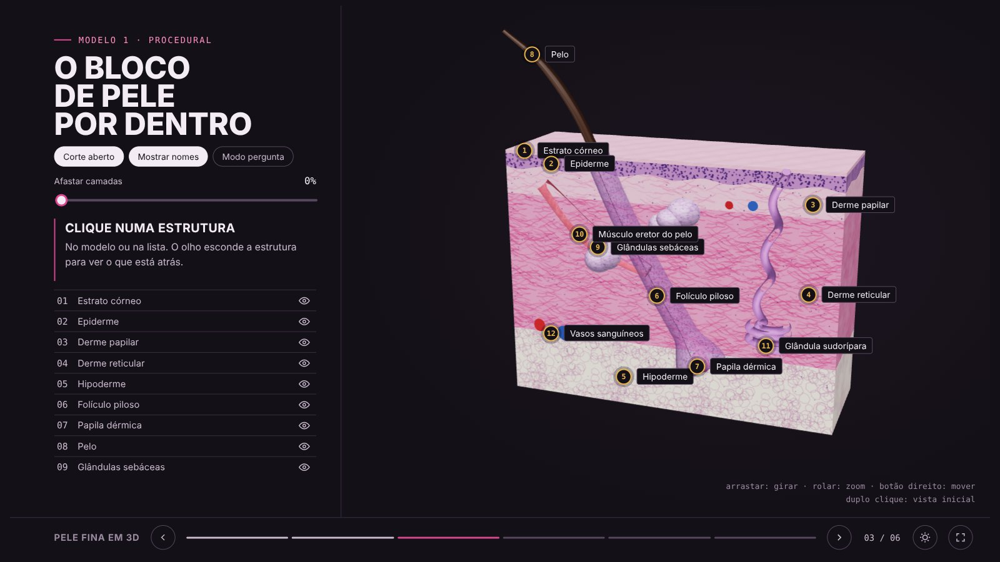
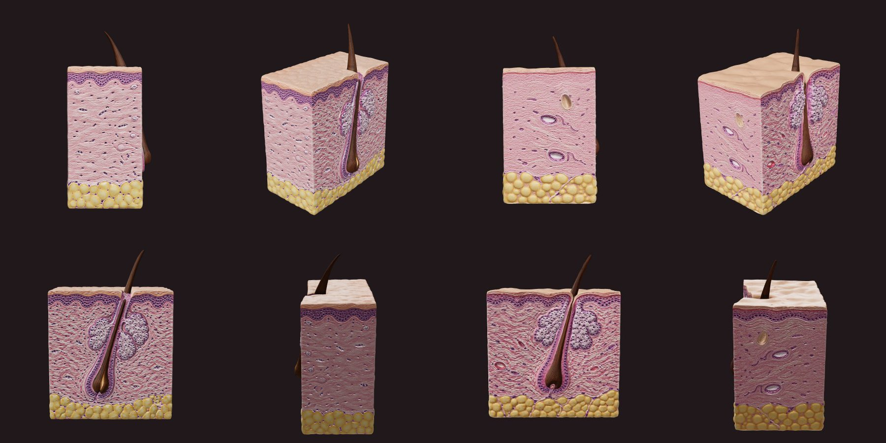

# Lab3D: histologia em 3D

Este repositório transforma lâminas de histologia em modelos 3D interativos (`.glb`) para aulas. O primeiro caso é a **pele fina**: epiderme, derme, folículo piloso, pelo e glândulas sebáceas.

Testamos dois caminhos:

| | Procedural (este repositório) | Gerado por IA (Higgsfield) |
|---|---|---|
| Como é feito | código three.js em `src/skin-model.js` | ilustração por IA convertida em malha (Tripo H3.1) |
| Partes separadas | sim, com 12 estruturas nomeadas | não, é uma malha única |
| Dados no GLB | nome, descrição e posição do marcador de cada estrutura (`extras`) | só geometria e textura |
| Ajuste | muda um número e roda o build de novo | gera de novo |
| Estruturas internas | volumes reais (folículo, glândulas, vasos) | **pintadas na face do corte**; só o pelo tem volume |



Modelos da IA, versões A e B (4 vistas cada):



## Estrutura

```
src/skin-model.js           geometria, materiais e texturas tipo H&E (unidades em mm)
tools/export-procedural.mjs gera o GLB num Chromium headless (Playwright)
tools/export.html           página usada pelo exportador
tools/test-page.mjs         captura os slides da aula nos temas claro e escuro
tools/compress_glb.py       recomprime as texturas de um GLB (os da IA caíram de 22 MB para 3,4 MB)
tools/preview-glb.mjs       renderiza 4 vistas de qualquer GLB
tools/web-models.mjs        copia models/*.glb para web/models/*.txt (base64) para a página
models/                     GLBs prontos para uso (three.js, Unity, Blender, <model-viewer>)
                            pele_fina_procedural.glb, pele_fina_ia_a.glb, pele_fina_ia_b.glb
web/index.html              aula interativa (6 slides)
docs/previews/              imagens de conferência
```

## Gerar o modelo

```bash
npm install
```

```bash
npm run build:pele
```

Isso grava `models/pele_fina_procedural.glb` e `web/models/pele_fina_procedural.txt`, a cópia em base64 que a página carrega. Outras opções:

- `npm run build:pele:previas`: gera também as imagens em `docs/previews/`.
- `node tools/export-procedural.mjs --usdz`: gera também o `.usdz` para AR no iPhone. O arquivo tem cerca de 20 MB e não vai para o git.

## Estrutura do GLB

```
Pele fina
├── Estrato córneo      (posterior | anterior)
├── Epiderme            (posterior | anterior)
├── Derme papilar       (posterior | anterior)
├── Derme reticular     (posterior | anterior)
├── Hipoderme           (posterior | anterior)
├── Folículo piloso     (bainha translúcida)
├── Papila dérmica
├── Pelo
├── Glândulas sebáceas  (dois cachos + ductos)
├── Músculo eretor do pelo
├── Glândula sudorípara
└── Vasos sanguíneos    (plexo profundo e superficial)
```

Cada camada é dividida no plano de corte (z = 0). Esconder as metades `anterior` abre o bloco como uma lâmina. Os grupos guardam em `extras`:

- `info`: texto didático;
- `marcador`: posição [x, y, z] em mm;
- `tipo`: `camada` ou `estrutura`.

> O GLTFLoader do three.js troca espaços por `_` em `.name`. O nome original fica em `userData.name`.

## Aula interativa

`web/index.html` segue o molde da skill **aula-interativa**. Ela tem 6 slides: capa, lâmina original, modelo procedural, modelo da IA, comparação e revisão.

- **Modelo procedural:** abre e fecha o corte, afasta as camadas, esconde cada estrutura, tem marcadores numerados e modo pergunta.
- **Modelo da IA:** alterna entre as versões A e B, mostra a ilustração 2D de origem e aceita qualquer outro `.glb` solto na bancada.

Antes de abrir a página, rode `npm run web:modelos` para gerar os arquivos base64 em `web/models/`.

Para testar localmente, sirva a pasta `web/`:

```bash
python3 -m http.server -d web 8000
```

## Modelos da IA

Os modelos foram gerados na Higgsfield em duas etapas:

1. **Ilustração:** GPT Image, a partir de um texto que descreve a lâmina.
2. **Malha:** Tripo H3.1 (image to 3D), com textura PBR detalhada e limite de 60 mil faces.

Os GLB originais tinham cerca de 22 MB cada. As texturas foram reduzidas para 2048 px com:

```bash
python3 tools/compress_glb.py original.glb models/pele_fina_ia_a.glb --max 2048
```

## Observações

- Proporções e cores são didáticas. Um professor de histologia deve conferir nomes e posições.
- A lâmina original (`web/img/lamina_pele_fina.jpg`) é material do professor.
